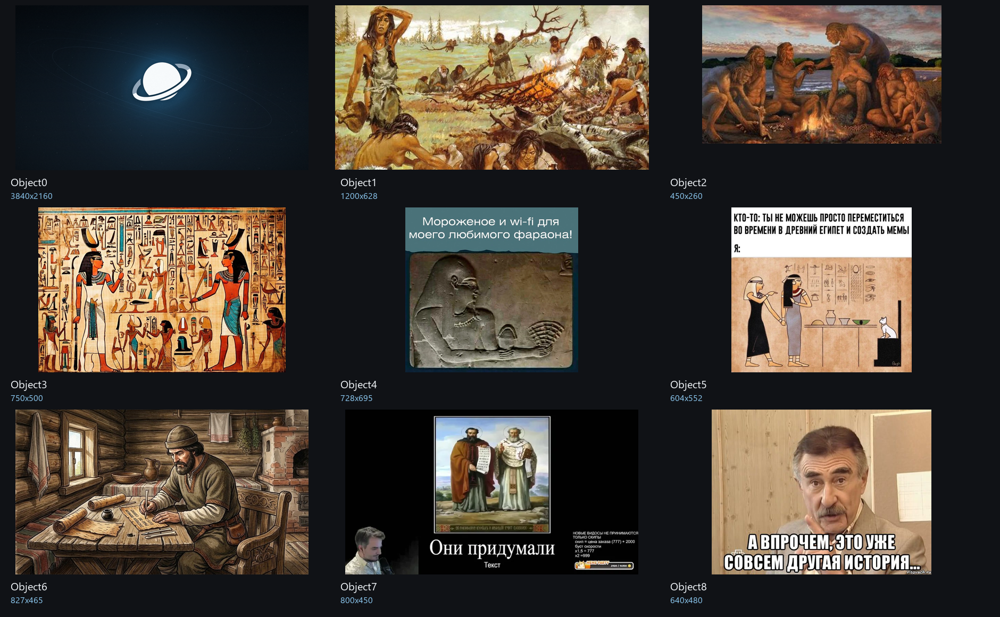

# Аудит проекта Orbita.vproj

Разбор: 19.11.2026. Проект — VSDC Free Video Editor (по строкам
`%AppDataPath%\FlashIntegro\VideoEditor\FileCache\ProxyMedia` в файле).
Формат `.vproj` — контейнер OLE, внутри бинарные потоки; медиа лежат прямо
в проекте, поэтому их удалось извлечь и измерить.

Что разобрано точно: настройки проекта, все девять исходников (размер,
яркость, контраст, цветовой баланс), три аудиофайла (формат, громкость, пики),
структура (3 слоя, 13 объектов). Что не разобрано: точные тайминги клипов —
формат бинарный, без схемы VSDC их не восстановить. Поэтому замечания по
ритму и склейкам — общие, а не «на 1:23 у вас рывок».

---

## 1. Паспорт проекта

| Параметр | Значение | Оценка |
|---|---|---|
| Разрешение | 1920 × 1080 | нормально для защиты |
| Частота кадров | **30 fps** | спорно: исходники статичные, а TV-фон у нас 25 fps |
| Аудио | 44 100 Гц, 2 канала | для видео лучше 48 000 Гц |
| Слоёв | 3 | мало для титров и подложек |
| Объектов в сцене | 13 | на 9 исходников — есть дубли или текстовые слои |
| Исходники | 9 PNG, встроены в проект | переносимые, это плюс |

---

## 2. Кадры: главная проблема

| # | Кадр | Размер | Апскейл до 1080p | Яркость | R/B |
|---|---|---|---|---|---|
| 0 | логотип Orbita | 3840×2160 | 0,50× (запас) | 31 | 0,47 |
| 1 | первобытные люди у костра | 1200×628 | **1,72×** | 137 | 1,72 |
| 2 | первобытная сцена крупно | 450×260 | **4,27×** | 89 | 1,67 |
| 3 | египетская фреска | 750×500 | **2,56×** | 138 | 1,98 |
| 4 | мем «Мороженое и wi-fi» | 728×695 | **2,64×** | 92 | 1,06 |
| 5 | мем «переместиться в Египет» | 604×552 | **3,18×** | 178 | 1,32 |
| 6 | писец за работой | 827×465 | **2,32×** | 79 | 1,70 |
| 7 | Кирилл и Мефодий (скриншот) | 800×450 | **2,40×** | 46 | 1,12 |
| 8 | мем «совсем другая история» | 640×480 | **3,00×** | 158 | 1,47 |

Средний апскейл — **2,76×**, максимум **4,27×**. Это значит, что один пиксель
исходника растягивается на четыре с лишним пикселя кадра: картинка мылится,
мелкий текст на мемах превращается в кашу, а артефакты сжатия лезут в глаза.
На проекторе это видно сильнее, чем на мониторе.

**Что делать (по убыванию эффекта):**

1. **Найти исходники крупнее.** Картины — на Wikimedia Commons (там же
   лицензии), фрески — в музеях, мемы — пересобрать заново в 1920×1080.
2. **Не растягивать на весь кадр.** Поставить картинку «карточкой» 55–70 %
   ширины на брендовый фон (наш `bg_logo_center_4k.png` как подложка). Тогда
   апскейл падает до 1,5–1,9×, и это выглядит как приём, а не как брак.
3. **Апскейл нейросетью** (Topaz, Real-ESRGAN) для тех кадров, что менять
   нечем: 2× обычно спасает живопись, 4× — уже с артефактами.
4. **Мемы пересобрать вручную** в 1080p: тот же шрифт (Impact / Arial Black),
   белая обводка 4–6 px, отступы от краёв. Из 450×260 нормальный мем не
   получится никак.

---

## 3. Скриншот YouTube — самая заметная ошибка

Кадр №7 — это не картинка, а **запись чужого ролика с интерфейсом**:

- внизу слева — ведущий с микрофоном;
- подпись «Они придумали» и кнопка «Текст»;
- справа внизу — логотип **МЕДИАКЛИК**, текст «НОВЫЕ ВИДЕО НЕ ПРИНИМАЮТСЯ…»
  и таймкоды «2020 / 16:00».

Проблемы сразу три: визуальный мусор, чужие права и ощущение «взял из ютуба
первое, что нашлось». Даже если обрезать по иконе, останутся артефакты
пережатия и водяной знак.

**Решение:** взять икону Кирилла и Мефодия в нормальном разрешении (Wikimedia,
public domain), либо сгенерировать стилизованную карточку с двумя силуэтами
и подписью. Одна минута работы — и кадр перестаёт быть уликой.

---

## 4. Скачки яркости и цвета

Яркость кадров гуляет от **31 до 178** (дельта 147), цветовой баланс R/B —
от **0,47** (холодный логотип) до **1,98** (тёплая живопись). При монтаже это
значит: каждый переход «логотип → картина → мем» — вспышка по яркости и
смене температуры. Глаз устаёт за минуту, а видео кажется «сделанным из
разных фильмов».

**Что делать:**

- привести всё к одному диапазону: яркость 45–55 % для исторических кадров,
  мемы оставить светлыми, но посадить на общую подложку;
- единый грейд: лёгкий тёплый оттенок и снижение насыщенности на живописи,
  чтобы она не спорила с мемами;
- мемы не ставить на белый фон вплотную к краю — дать рамку 6–8 % кадра;
- проверить на телевизоре или проекторе: там перепады видны в два раза сильнее.

---

## 5. Пропорции и кадрирование

В проекте смешаны 16:9, 4:3 (640×480, 827×465), почти квадрат (604×552,
728×695). Если ставить «по размеру кадра» — вылезут чёрные полосы; если
«заполнить» — обрежутся лица и текст на мемах.

**Правило, которое стоит зафиксировать:**

- исторические кадры и живопись — в рамке 16:9 с размытой подложкой из того же
  кадра (в VSDC это «Фон → Размытие» или дубль объекта под низом);
- мемы — целиком, по центру, на брендовой подложке, без обрезки;
- вертикальные кадры (450×260, 640×480) — в карточке 60 % высоты, не на весь
  экран.

---

## 6. Звук

| Файл | Длительность | Формат | Громкость | Пик |
|---|---|---|---|---|
| `1.mp3` | 0:18 | 24 кГц, моно, 79 кбит/с | −14,6 LUFS | **+0,7 dBTP** |
| `Sammy_Kaye_-_Aint_She_Sweet` | 2:22 | 44,1 кГц, стерео, 320 кбит/с | −15,3 LUFS | +0,1 dBTP |
| `Lost_Weekend…Valley` | 3:07 | 44,1 кГц, стерео, 256 кбит/с | **−6,8 LUFS** | +0,5 dBTP |

Что это значит на практике:

1. **`1.mp3` уже клиппует** (+0,7 dBTP) и записан в 24 кГц моно на 79 кбит/с.
   Для звукового акцента сойдёт, для музыки — нет. Заменить на 48 кГц.
2. **`Lost_Weekend` — «кирпич»**: −6,8 LUFS при разбросе всего 0,7 LU. Это
   мастер, зажатый лимитером. Под голос он будет драться; если ставить, то
   −20…−24 dB и с высокочастотным фильтром ниже 100 Гц.
3. **Оба трека на пределе по пикам** (+0,1 и +0,5 dBTP). В проекте их надо
   опустить, а на экспорте поставить лимитер −1 dBTP, иначе AAC добавит
   искажений.
4. **Голоса в проекте нет.** Если ролик планируется с озвучкой — её нужно
   записывать отдельно и сводить на −16…−14 LUFS, музыку под ней — на
   −20…−24 dB с дакингом.
5. **Права.** Sammy Kaye — старая запись, но не обязательно public domain;
   Lost Weekend — современная группа. Для публикации на YouTube почти
   гарантированный Content ID. Для защиты в аудитории это не проблема, для
   выкладки — замените на библиотеку с лицензией.

---

## 7. Ошибки монтажа, которые видно уже сейчас

1. **Статичные кадры на весь экран.** Девять картинок на три минуты — это
   в среднем по 20 секунд на кадр, если растягивать. Даже 8 секунд статики
   зритель выдерживает с трудом. Нужно движение: медленный наезд 100 → 106 %,
   панорама, или смена кадра на музыкальной доле.
2. **Нет единого ритма.** Мемы, живопись и скриншот живут в разных темпах.
   Задайте правило: исторические кадры — 5–7 секунд, мемы — 2–3 секунды
   (мем должен «ударить» и уйти).
3. **Эффект телевизора в VSDC.** В настройках объектов встречается параметр
   `RandomDotStereoTV` — похоже, шум «старого телевизора» сделан эффектом.
   Такой шум статичный, он не живёт по кадрам. Наш `orbita_tv_5s.mp4` даёт
   настоящую аналоговую помеху — им лучше заменить эффект.
4. **30 fps при 25-кадровом фоне.** Если вставите наш TV-ролик (25 fps)
   в 30-кадровый проект, получите рывок каждые пять кадров. Либо пересобрать
   фон в 30 fps, либо поставить проект на 25 fps.
5. **Титры.** Отдельного слоя под подписи не видно — если текст лежит на том же
   слое, что картинка, он будет дёргаться вместе с ней. Держите текст отдельным
   верхним слоем, кегль не меньше 44 px при 1080p, отступ от края 5 %.

---

## 8. Что настроить перед экспортом

| Параметр | Рекомендация |
|---|---|
| Кодек | H.264, High profile |
| Битрейт | 16–20 Мбит/с VBR, 2 прохода (для YouTube хватит 12–16) |
| Аудио | AAC, 48 кГц, 320 кбит/с, стерео |
| Громкость | −14 LUFS для интернета, −16 LUFS для показа в зале |
| Пик | не выше −1 dBTP |
| Цвет | Rec.709, без двойной конвертации |
| Частота кадров | 30 или 25 — выбрать одну и не смешивать |

В VSDC это «Проект → Настройки проекта» (разрешение, fps, аудио) и
«Проект → Настройки экспорта» (профиль H.264). Проверьте, что профиль не
«автоматический»: он любит подставлять битрейт по исходникам и на мемах
экономит.

---

## 9. План правок на один вечер

1. Заменить скриншот YouTube на чистую икону (20 мин).
2. Пересобрать три мема в 1920×1080 (40 мин).
3. Поставить слабые кадры карточками на брендовую подложку или апскейлить
   в 2× (40 мин).
4. Прогнать единый грейд: яркость, насыщенность, лёгкое тепло (30 мин).
5. Добавить движение на статичные кадры и выровнять длительности
   (30 мин).
6. Свести звук: −20 dB под голосом, фейды 0,3–0,5 с, лимитер −1 dBTP
   (20 мин).
7. Экспортировать черновик и посмотреть на телефоне и на большом экране
   (15 мин).

---

## 10. Что нельзя исправить монтажом

- Разрешение исходников: 450×260 не станет 1080p без потерь.
- Интерфейс и водяные знаки в скриншоте.
- Права на музыку и на чужое видео.
- Отсутствие озвучки, если она нужна по сценарию.

---

## 11. Чем могу помочь дальше

- Собрать чистую икону Кирилла и Мефодия или стилизованную карточку.
- Пересобрать мемы в 1080p с нормальным шрифтом и отступами.
- Сделать апскейл слабых кадров (2×) и сравнить «до/после».
- Пересобрать TV-фон в 30 fps под ваш проект.
- Разобрать экспортированный черновик MP4: тайминги склеек, уровни звука,
  рывки, читаемость титров — по кадрам, а не на глаз.
